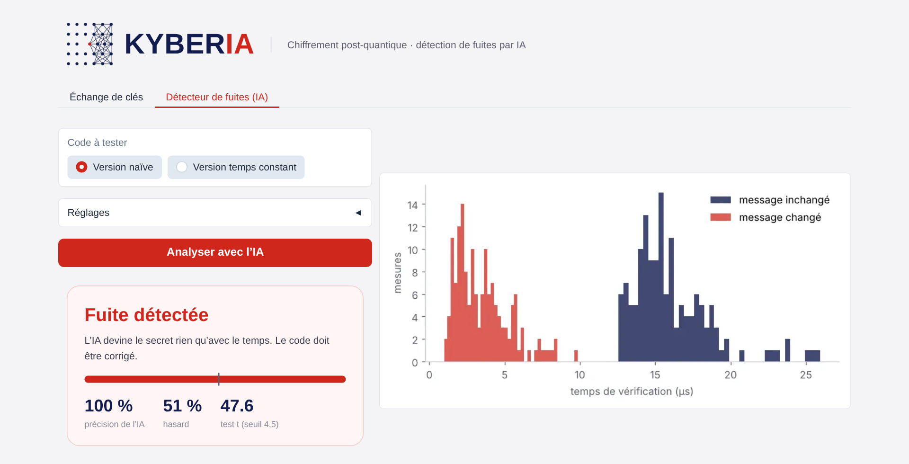
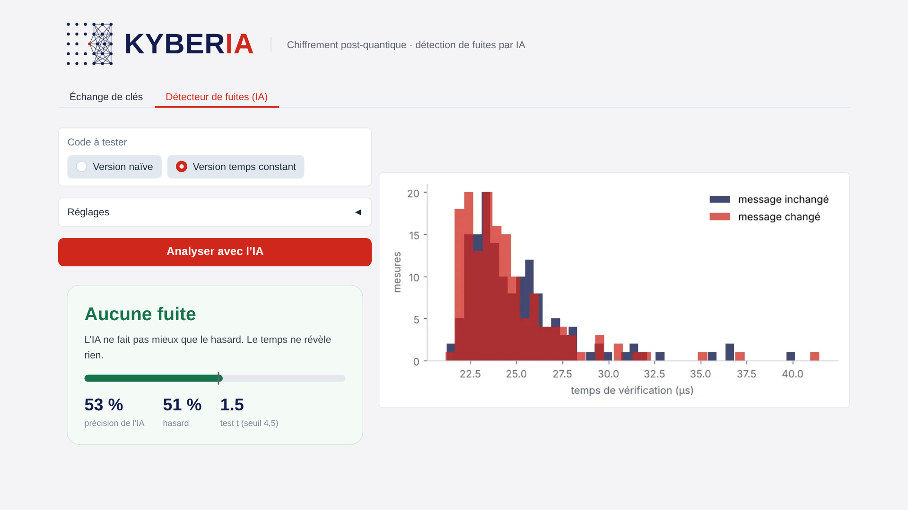
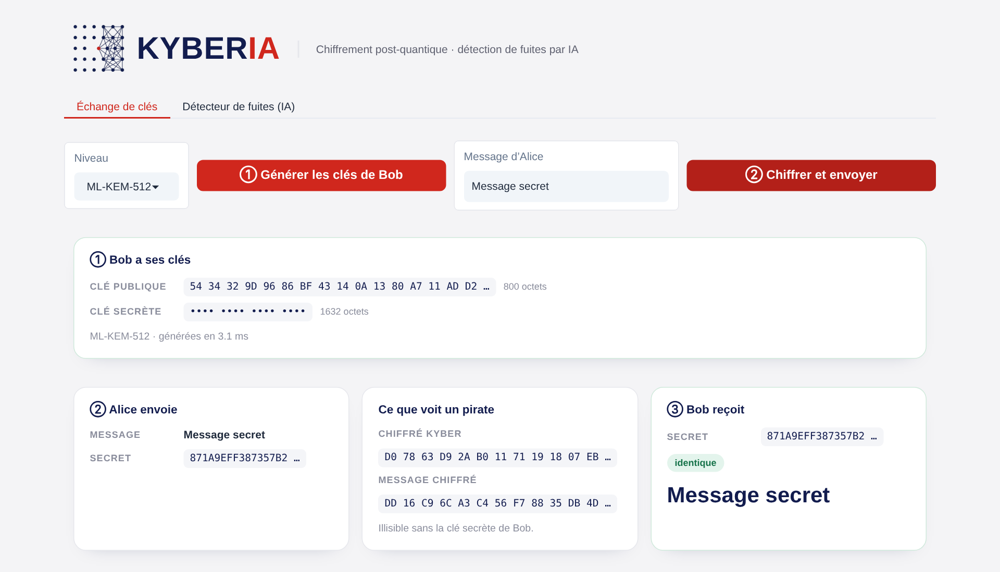

# KyberIA

  -121C4E) 

**Kyber (ML-KEM, standard NIST FIPS 203) écrit à partir de zéro en Python,
et une IA qui vérifie que le code ne laisse pas fuir la clé secrète.**

## Aperçu

| Le code naïf : l'IA détecte la fuite | Le code corrigé : aucune fuite |
|---|---|
|  |  |

**Échange de clés Alice → Bob** avec Kyber, et ce que voit un pirate :



## Pourquoi ?

Un ordinateur quantique pourra casser RSA. Le NIST a choisi **Kyber (ML-KEM)** comme nouveau standard
d'échange de clés « post-quantique ».

Mais un algorithme sûr sur le papier peut être **mal codé**. Par exemple, si le temps de calcul dépend
d'une information secrète, un pirate peut mesurer ce temps, essai après essai, et reconstruire la clé.
C'est une **attaque par canal auxiliaire**.

## Ce que fait le projet

1. **Kyber complet**, sans bibliothèque de cryptographie : NTT, bruit (loi binomiale centrée), compression,
   K-PKE, et le mécanisme ML-KEM avec rejet implicite. Les 3 niveaux sont disponibles : 512, 768 et 1024.
   Le résultat est **identique octet par octet** à l'implémentation de référence `kyber-py` (`test_kyber.py`).
2. **Un détecteur de fuites par IA.**
   - On envoie des chiffrés légèrement modifiés et on mesure le temps de l'étape de vérification.
   - Une IA (forêt aléatoire) reçoit **seulement ces temps** et essaie de deviner une information secrète :
     le message déchiffré a-t-il changé ?
   - Si l'IA devine nettement mieux que le hasard, **le code laisse fuir la clé**.
3. **Deux versions de la vérification** pour le prouver :
   - **naïve**, écrite volontairement avec le défaut : elle s'arrête à la première différence.
     Résultat : **fuite détectée**, l'IA devine à environ 100 % (test t de Welch ≈ 47, seuil 4,5) ;
   - **temps constant**, la version corrigée. Résultat : **aucune fuite**, l'IA reste autour de 50 %,
     comme le hasard (test t ≈ 1,5).

> Ce type de défaut existe dans la réalité : en 2023, la faille **KyberSlash** a touché plusieurs
> implémentations de Kyber à cause d'un temps de calcul qui dépendait du secret.

## Lancer

```bash
git clone https://github.com/Rached12364/KyberIA.git
cd KyberIA
pip install -r requirements.txt
python test_kyber.py      # (optionnel) vérification contre la référence : pip install kyber-py
python leakage.py         # détecteur en ligne de commande
python app.py             # application : http://127.0.0.1:7860
```

## Fichiers

| Fichier | Rôle |
|---|---|
| `kyber.py` | Kyber / ML-KEM complet (FIPS 203) + les deux comparaisons |
| `leakage.py` | Mesure des temps, IA (forêt aléatoire), test statistique de Welch |
| `docs/` | Captures d'écran de l'application |
| `app.py` | Interface claire : échange de clés Alice → Bob, puis détecteur de fuites |
| `test_kyber.py` | Vérifie que le résultat est identique à `kyber-py` |

## Limites (honnêtes)

- Le code est écrit en Python pour être lisible. Il n'est pas fait pour protéger de vraies données.
- En Python, le bruit du système cache une si petite différence dans le temps total. On mesure donc
  **le temps de l'étape de vérification**, comme le ferait une sonde de mesure. Le curseur « bruit de mesure »
  permet d'ajouter du bruit pour rendre l'exercice plus réaliste.
- La version naïve est volontairement fautive : elle sert à montrer que l'IA détecte bien un vrai défaut.

## Auteur

**Rached ILAHI** — élève ingénieur en génie informatique, ENICarthage · projet en cours

[LinkedIn](https://www.linkedin.com/in/rached-ilahi-5b5101366/) · [Portfolio](https://rached12364.github.io/)
